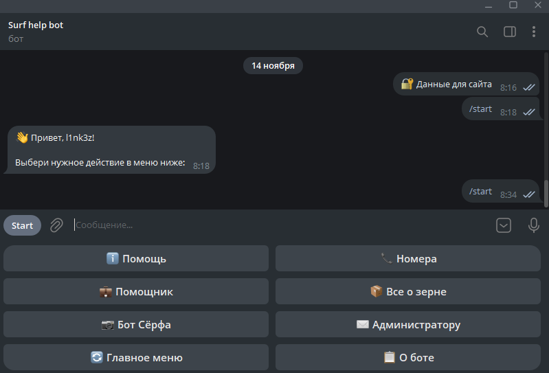
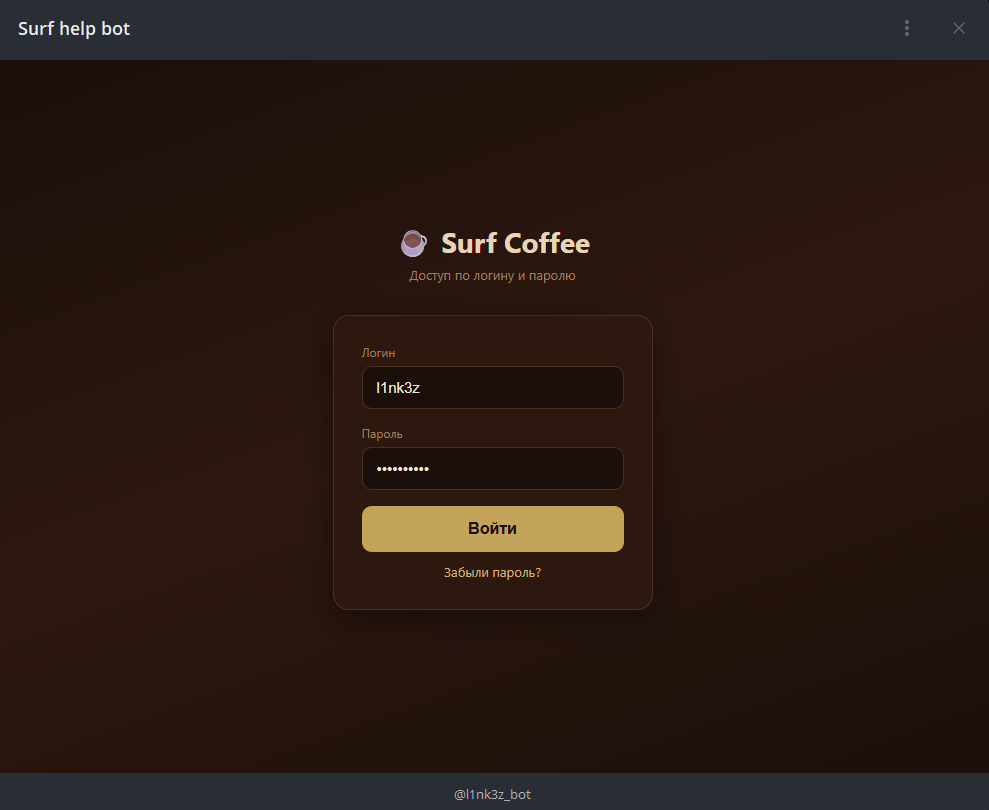
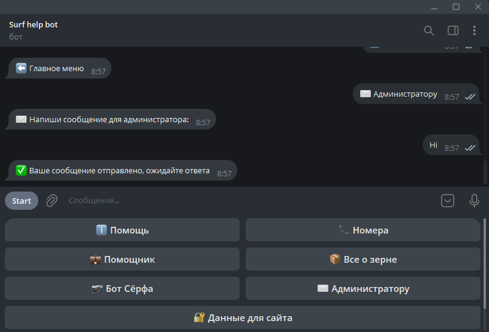
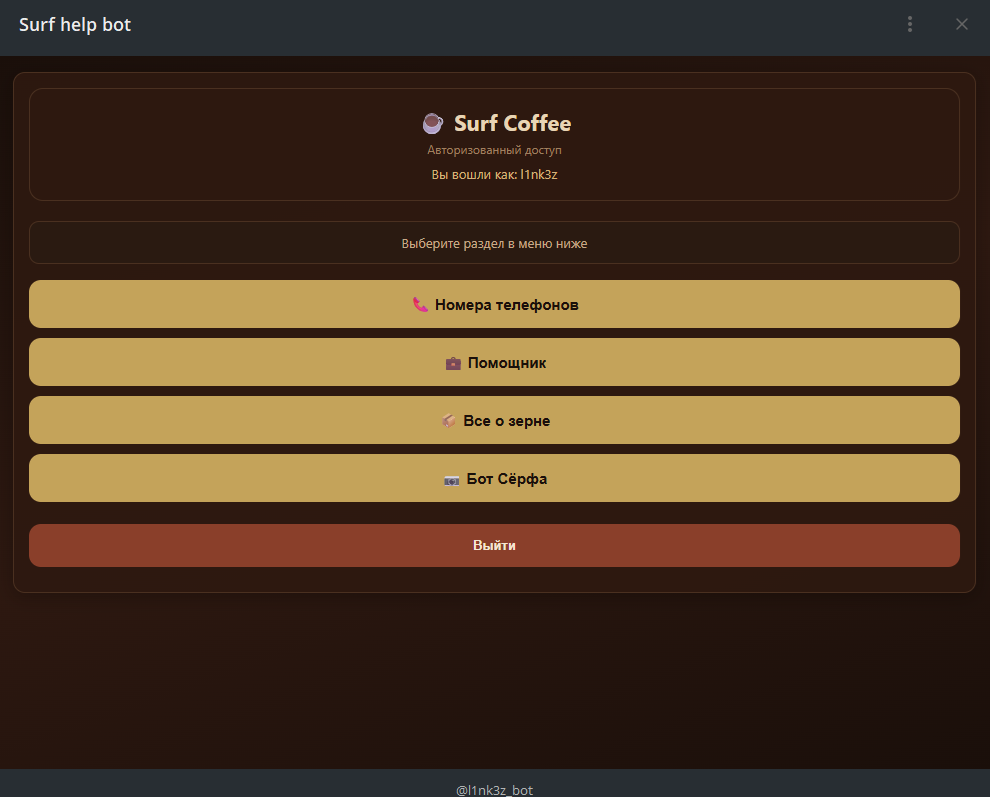
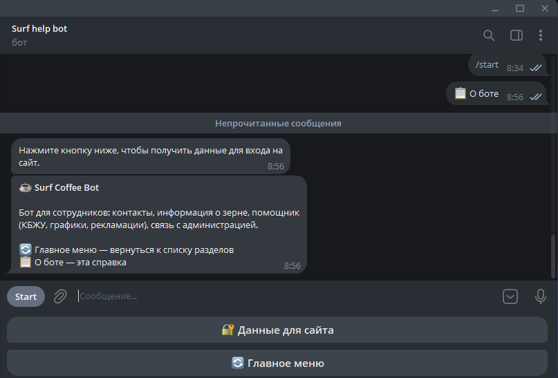
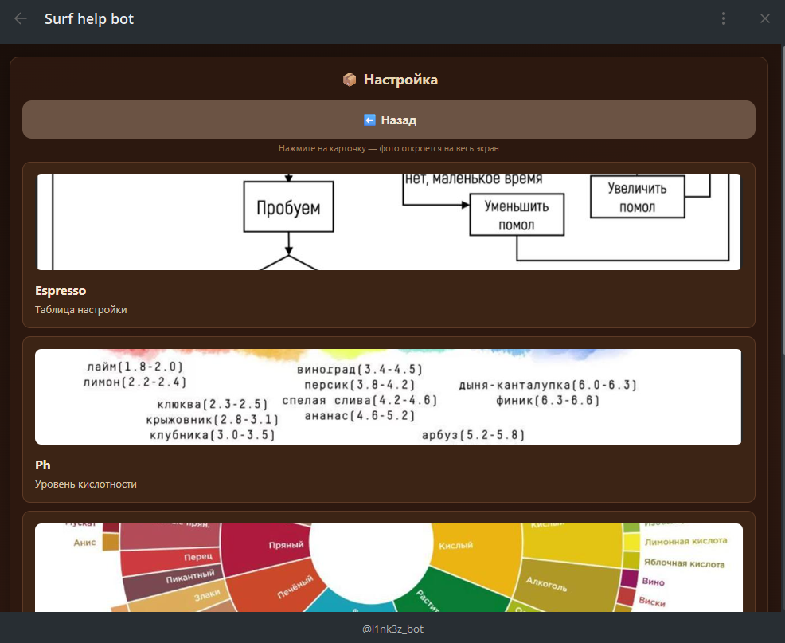
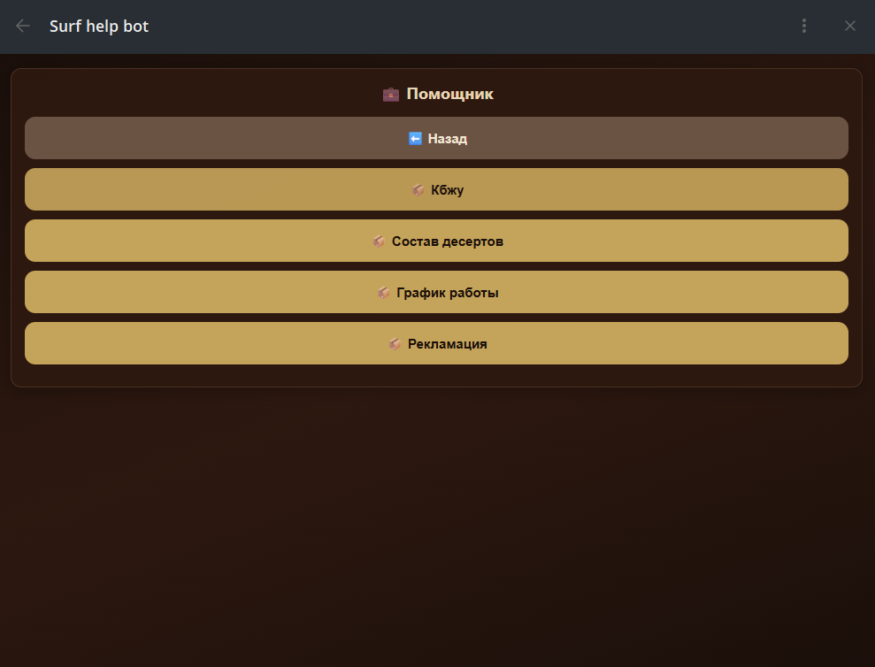
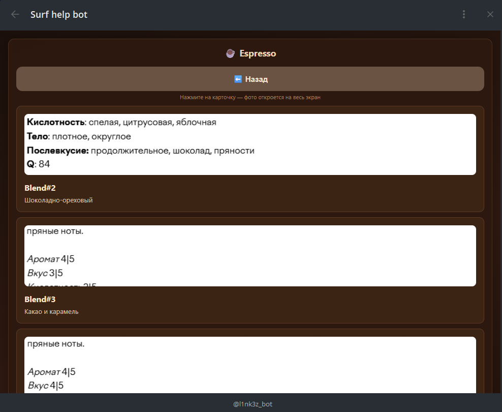
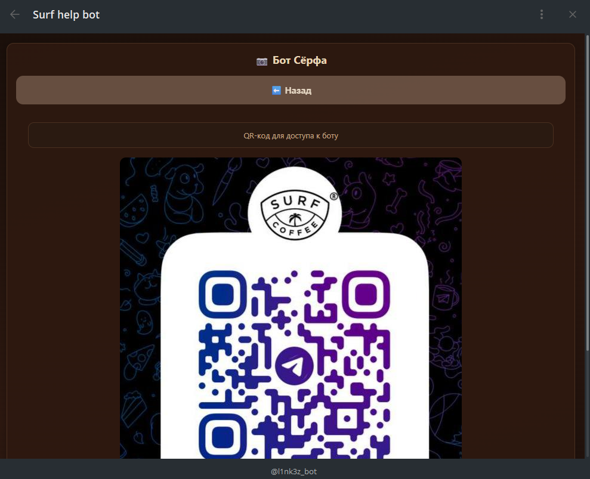

# Surf Help Bot

Telegram-бот и мини-приложение для сотрудников кофейни: быстрый доступ
к телефонам, справочнику по зерну, помощнику и связи с администратором.
Используется в реальной работе с 2025 года.

## Скриншоты

| Бот | Мини-приложение |
|-----|-----------------|
|  |  |
|  |  |
|  |  |
|                        |  |
|                        |  |
|                        |  |

## Возможности

- Справочные разделы: номера телефонов, информация о зерне, помощник, qr - поддержки
- Связь с администратором прямо из бота - общение с администратором производится прямо в боте
- Telegram Mini App с авторизацией по данным, которые выдаёт бот
  

## Стек

Go, Telegram Bot API, Telegram Mini App (WebApp),  GitHub Actions

## Структура проекта

- `web/` — веб-часть мини-приложения
- `zerno/` — полезная информация о зерне : регион, аромат, дескрипторы, тело, Q-грейд
- `helpzerno/` — помогает бариста в настройке зерна : таблица настройки, уровень кислотности, колесо дескрипторов, таблица экстракции
- `.github/workflows/` — Автоматический деплой мини-приложения на GitHub Pages

## Запуск

1. Установите Go
2. Склонируйте репозиторий и перейдите в папку бота:
   ```bash
   git clone https://github.com/L1nk3z/l1nk3zbot.git
   cd l1nk3zbot/Go
   ```
3. Создайте файл настроек и впишите токен бота:
   ```bash
   cp ../.env.example .env
   ```
4. Запустите:
   ```bash
   go run .
   ```

## Настройки

| Переменная | Описание |
|------------|----------|
| `BOT_TOKEN` | Токен бота от @BotFather |

## Планы

- Перенос проекта полностью на Vps сервер
- Проверка проекта на стресс тестах
- Проверка проекта командой

## Контакты

Telegram: @l1nk3z
